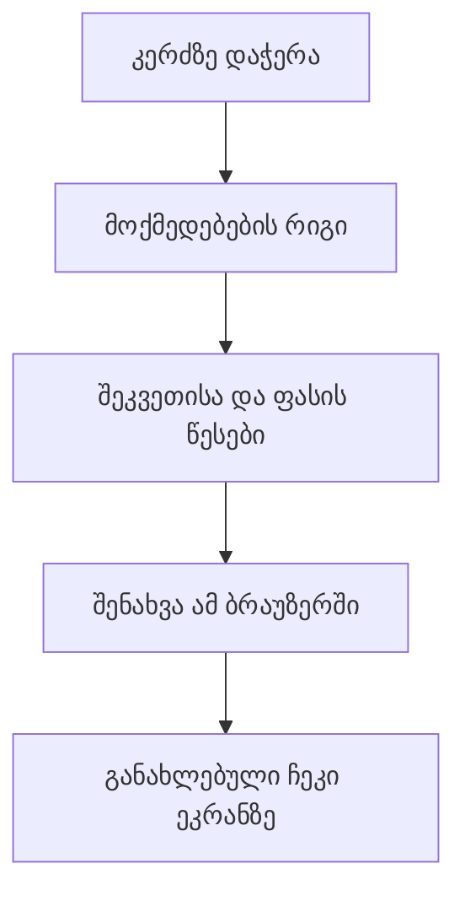

# ORVIO — შესვლის გარეშე დემო

მთავარი გვერდი პირდაპირ ხსნის მაგიდებს. სტუმარს ანგარიშის შექმნა და პაროლის შეყვანა არ სჭირდება. თითოეული ბრაუზერი იღებს საკუთარ საცდელ მენიუსა და შეკვეთებს.

## როგორ მუშაობს

1. `components/pos-workspace.tsx` აჩვენებს ეკრანს და იღებს დაჭერას.
2. `lib/serial-queue.ts` მოქმედებებს რიგში ატარებს: ათი სწრაფი დაჭერა ათ ერთეულს უნდა ნიშნავდეს.
3. `lib/pos.ts` წყვეტს, რამდენი უნდა გახდეს რაოდენობა, ფასი და გადასახდელი თანხა. ეს ერთი და იგივე წესებია როგორც დემოში, ისე ანგარიშით შესვლისას.
4. `lib/demo-store.ts` ინახავს მთლიან სამუშაო მდგომარეობას ბრაუზერის `localStorage`-ში. `localStorage` საიტისთვის გამოყოფილი მცირე ადგილობრივი საცავია. მონაცემი გვერდის განახლებას უძლებს, მაგრამ ბრაუზერის მონაცემების გასუფთავებისას იშლება.
5. მხოლოდ წარმატებული შენახვის შემდეგ ბრუნდება ახალი მდგომარეობა ეკრანზე. თუ საცავი სავსეა ან ბრაუზერი შენახვას კრძალავს, მომხმარებელი შეცდომას ხედავს.

## ორი რეჟიმი

| რეჟიმი | მისამართი | სად ინახება შეკვეთები | ვისთან გაზიარდება |
| --- | --- | --- | --- |
| დემო | `/` | მხოლოდ ამ ბრაუზერში | იმავე ბრაუზერის ფანჯრებთან |
| ანგარიშით შესვლა | `/workspace` | Supabase PostgreSQL-ში | იმავე ანგარიშის მოწყობილობებთან |

დემოს გახსნა დაცულ მონაცემებზე წვდომას არ აძლევს. `/api/pos` კვლავ ამოწმებს სესიას. დემო არც ამ API-ს მიმართავს და არც Supabase-ის გასაღებებს იღებს. დემოში შეგროვილი შეკვეთები ანგარიშზე ავტომატურად არ გადადის.

## მენეჯერის კოდი

საწყისი საცდელი კოდია **1234**. ის საშუალებას გაძლევთ გამოსცადოთ ფასდაკლება, გაუქმება და მაგიდების მართვა. ეს საჯაროდ ცნობილი დემოს კოდია და ნამდვილ ფინანსურ უსაფრთხოებას არ წარმოადგენს. მისი შეცვლა მხოლოდ იმავე ბრაუზერის დემოზე მოქმედებს. ანგარიშით შესვლისას საკუთარი მენეჯერის კოდი ცალკე იქმნება და სერვერზე მოწმდება.

## დღის დახურვა და მაგიდების განლაგება

**„ანგარიშები → დღის ანგარიში“** აჩვენებს არჩეული დღის ჯამებს და სალაროს შემოწმებას: ჩაწერეთ დილით დატოვებული თანხა და დათვლილი ნაღდი, ნახეთ სხვაობა და დააჭირეთ „დღის დახურვას“ კოდით **1234**. დახურვა გაყიდვას არ აჩერებს და შეკვეთებს არ ცვლის. წინა დახურვები ჩანს „დახურვების ისტორიაში“.

**„მაგიდები“** აჩვენებს დარბაზისა და ტერასის რუკას. ყველა რედაქტირება — მენიუ და ფოტოები, დარბაზის გეგმა, ზონები და მაგიდები, განყოფილებები, კალკულაციები, მენეჯერის კოდი — არის **„მართვაში“**. მაგალითად, **„მართვა“ → „დარბაზის გეგმა“ → „განლაგების რედაქტირება“**: გადაათრიეთ მაგიდები, შეცვალეთ ფორმა და ადგილები და შეინახეთ კოდით **1234**.

## საწყობის გამოცდა

ახალ დემოს უკვე აქვს საცდელი საწყობი: 10 ინგრედიენტი, ცეზარის სოუსი (ნახევარფაბრიკატი) და კალკულაციები ხაჭაპურზე, ცეზარზე და წყალზე. გახსენით მარცხენა მენიუში **„საწყობი“**, მიიღეთ საქონელი, ჩამოწერეთ ან დაითვალეთ კოდით **1234**. შემდეგ გააგზავნეთ ხაჭაპური რომელიმე მაგიდიდან და ნახეთ „მოძრაობებში“ ჩანაწერები „გაყიდვა“. თუ ძველი დემო გაქვთ, საცდელი მარაგისთვის დააჭირეთ „დემოს განულებას“. ნაბიჯ-ნაბიჯ ინსტრუქცია: [კალკულაცია და საწყობი — როგორ გამოვიყენოთ](INVENTORY.md#ნაწილი-3-როგორ-გამოვიყენოთ).

## რამდენიმე ფანჯარა და განულება

განყოფილების ცალკე ეკრანი იმავე ბრაუზერის საერთო საცავს კითხულობს. თანამედროვე ბრაუზერის Web Locks მექანიზმი ჩაწერებს რიგში ატარებს, ხოლო ვერსიის შემოწმება ძველ მდგომარეობაზე ჩაწერას აჩერებს. Web Locks-ის გარეშე ვერსიის შემოწმება რჩება, თუმცა ერთდროული მრავალფანჯრიანი ჩაწერის სრული გარანტია არ არსებობს.

„დემოს განულება“ დადასტურების შემდეგ აბრუნებს საწყის მენიუს, 12 მაგიდასა და კოდს 1234. ახალი დემო ახალ იდენტიფიკატორს იღებს, რათა ძველი ფანჯრის დაგვიანებულმა მოქმედებამ ახალი დემო ვერ შეცვალოს. სხვა ადამიანის ბრაუზერის ან Supabase-ის ჩანაწერები არ იცვლება.

ეს რეჟიმი გამოდგება ინტერფეისისა და სამუშაო პროცესის საჩვენებლად. დამოუკიდებელ მოწყობილობებზე მოლარისა და სამზარეულოს საერთო მუშაობა ანგარიშით შესვლის რეჟიმს საჭიროებს.
