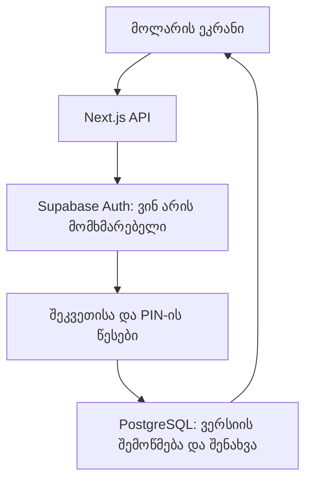

# Vercel + Supabase — განთავსება

მთავარი მისამართი `/` იხსნება შესვლის გარეშე, როგორც **ლოკალური დემო**. `/workspace` ინარჩუნებს ელფოსტითა და პაროლით შესვლას და Supabase-ში შენახვას. დემო რეჟიმს Supabase-ის გასაღებები არ სჭირდება და დაცული API-ს ავტორიზაციის წესს არ ცვლის.

დემოში ყველა სტუმარს აქვს საკუთარი ბრაუზერის მონაცემები და საწყისი მენეჯერის კოდი **1234**. მონაცემები სხვა მოწყობილობასთან არ სინქრონდება; იმავე ბრაუზერში განყოფილების ცალკე ფანჯარა საერთო ლოკალურ შეკვეთებს ხედავს. ახალი სუფთა დემოსთვის გამოიყენეთ „დემოს განულება“. ლოკალური საცავის გაწმენდა მონაცემებს წაშლის.

## 1. Supabase

შექმენით Supabase პროექტი თქვენს ანგარიშზე. SQL Editor-ში გაუშვით `supabase/schema.sql` ახალი ბაზის მოსამზადებლად. სქემა კლიენტებს პირდაპირ წვდომას არ აძლევს: ყველა ფინანსური ცვლილება ORVIO-ს სერვერსა და PIN-ის წესებს გადის.

Authentication-ში გამორთეთ საჯარო რეგისტრაცია. Users-დან შექმენით საჭირო მომხმარებელი და დააყენეთ ძლიერი პაროლი. აპში თვითრეგისტრაციის ღილაკი არ არის. პაროლის აღდგენა ამ ეტაპზე მფლობელის დახმარებით ხდება; ამ პროცესის საიდუმლო მონაცემები ჩატში ან GitHub-ში არ შეიტანოთ.

## 2. გარემოს ცვლადები

Vercel-ის Project Settings → Environment Variables-ში დაამატეთ:

| სახელი | მნიშვნელობა |
| --- | --- |
| `SUPABASE_URL` | პროექტის HTTPS URL |
| `SUPABASE_ANON_KEY` | პროექტის საჯარო/anon გასაღები ავტორიზაციისთვის |
| `SUPABASE_SERVICE_ROLE_KEY` | სერვერული service_role გასაღები — საიდუმლო |
| `ORVIO_ALLOWED_EMAILS` | დაშვებული ანგარიშების ელფოსტები, გამოყოფილი მძიმით |

არ გამოიყენოთ `NEXT_PUBLIC_` პრეფიქსი ამ ცვლადებისთვის. გასაღებები შეიტანეთ მხოლოდ Vercel-ის დაცულ გარემოს პარამეტრებში ან ლოკალურ `.env.local` ფაილში. საიდუმლო გასაღები არასოდეს ჩაწეროთ README-ში, commit-ში ან ჩატში.

## 3. Vercel

Add New → Project → GitHub → `khachidzenodar-sys/orvio-pos` → Import.

- Framework: **Next.js**
- Root directory: **./**
- Node.js: **22.x**
- Build: `npm run build` (უკვე მითითებულია vercel.json-ში)
- Package manager: `package.json` და `pnpm-lock.yaml` განსაზღვრავს pnpm-ს.
- Production branch: **main**

შეავსეთ ზემოთ მოცემული ცვლადები და შემდეგ დაიწყეთ Deploy. გარემოს ცვლადების მოგვიანებით შეცვლისას გაუშვით ახალი deployment. Preview გარემოსთვის გამოიყენეთ ცალკე საცდელი Supabase პროექტი, თუ რეალურ მონაცემებთან მუშაობთ.

## 4. ცოცხალი შემოწმება

1. `/` შესვლის ფორმის გარეშე უნდა ხსნიდეს მაგიდებს. საცდელი შეკვეთა შეინახეთ, განაახლეთ გვერდი და გადაამოწმეთ დარჩა თუ არა. ცალკე ბრაუზერში ახალი, ცარიელი დემო უნდა გამოჩნდეს.
2. ავტორიზაციის გარეშე `/api/pos` ისევ უნდა აბრუნებდეს 401-ს. `/workspace`-ზე დაშვებული ანგარიშით შედით და შექმენით მენეჯერის PIN.
3. გახსენით მაგიდა; კერძს სამჯერ დააჭირეთ — რაოდენობა უნდა იყოს 3 და ფასი გამრავლებული.
4. გააგზავნეთ განყოფილებებში; განმეორებითი გაგზავნა ახალ ჩეკს არ უნდა ქმნიდეს.
5. გადაამოწმეთ PIN-ით ფასდაკლება, ნაწილობრივი გადახდა და სრული დახურვა.
6. განაახლეთ გვერდი/შედით ხელახლა — შენახული შეკვეთები უნდა დარჩეს.
7. სხვა დაშვებული ანგარიშით გადაამოწმეთ მონაცემების იზოლაცია. დემოს მონაცემები ანგარიშით შესვლისას ავტომატურად არ გადადის ბაზაში.

ლოკალური ტესტები სერვერულ ლოგიკასა და HTTP კონტრაქტებს ამოწმებს ჩანაცვლებული Supabase-ით. ისინი რეალურ Supabase სქემასა და Vercel deployment-ს ვერ ადასტურებს; ზემო ცოცხალი შემოწმებები საჭიროა გარემოს დაკავშირების შემდეგ.

## მონაცემების გადატანა

Sites-ის D1 მონაცემები და Supabase-ის PostgreSQL მონაცემები ცალ-ცალკეა. მიმდინარე კოდის განთავსება არ ახდენს ძველი შეკვეთების, ანგარიშების ან PIN-ის ავტომატურ გადატანას. ძველი საცდელი საიტი რჩება ხელმისაწვდომი. ისტორიის გადატანა უნდა შესრულდეს ცალკე, დადასტურებული ანგარიშების შესაბამისობითა და შედეგის შემოწმებით.

## როგორ მოძრაობს შეკვეთა

ვერსიის შემოწმება ორ ერთდროულ მოქმედებას ძველი მონაცემების ერთმანეთზე გადაწერის საშუალებას არ აძლევს. საიდუმლო გასაღები მხოლოდ სერვერზეა. მომხმარებლის მიერ გამოგზავნილი პირადობის სათაური ავტორიზაციის საფუძველი არ არის.

ოფიციალური ცნობარები: https://vercel.com/docs/frameworks/nextjs · https://vercel.com/docs/environment-variables · https://supabase.com/docs/guides/auth/passwords · https://supabase.com/docs/guides/database/postgres/row-level-security
